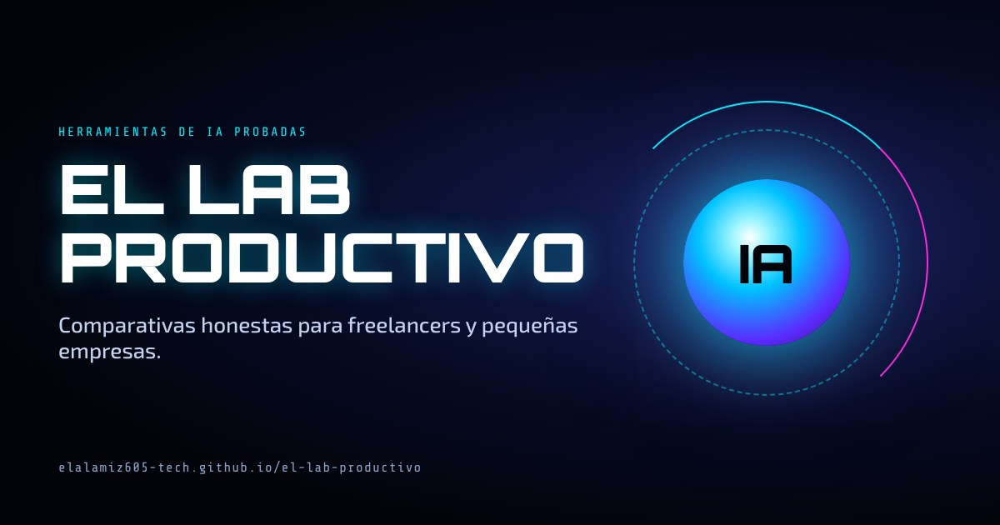

# El Lab Productivo

**Herramientas de IA probadas para trabajar mejor y más rápido.**

Blog independiente en español para freelancers y pequeñas empresas: comparativas honestas de herramientas de inteligencia artificial, métodos concretos y una guía gratuita de 50 prompts.

🌐 **Web:** https://elalamiz605-tech.github.io/el-lab-productivo/



## Características

- **Diseño futurista**: estética neón (cian, violeta, magenta), tipografías Orbitron, Exo 2 y Share Tech Mono.
- **Vídeo de fondo** generado a partir de una escena 3D de partículas (cabeza holográfica, red neuronal, la mano que toca la IA), con versión horizontal y vertical.
- **Animaciones en CSS** aceleradas por GPU: núcleo «IA» con anillos orbitales, título con efecto *glitch*, cuadrícula 3D, tarjetas con bordes de neón y un libro 3D.
- **Rendimiento en móvil**: modo ligero automático, un solo vídeo elegido según la pantalla y pausado cuando no se ve, secciones fuera de pantalla sin renderizar.
- **100 % estático**: HTML y CSS, sin dependencias ni paso de compilación. Alojado gratis en GitHub Pages.
- **SEO básico**: `sitemap.xml`, `robots.txt`, URLs canónicas e imagen para compartir en redes (Open Graph).

## Estructura

| Archivo | Contenido |
|---|---|
| `index.html` | Página de inicio |
| `sobre-nosotros.html` | Quién está detrás del blog |
| `contacto.html` | Formulario de contacto |
| `afiliacion.html`, `privacidad.html`, `cookies.html`, `aviso-legal.html` | Páginas legales (LSSI-CE, RGPD) |
| `futur.css`, `futur-gen.css` | Estilos y animaciones |
| `film-landscape.mp4`, `film-portrait.mp4` | Vídeo de fondo (ordenador / móvil) |
| `sitemap.xml`, `robots.txt` | Indexación en buscadores |

## Ver el sitio en local

No hace falta instalar nada:

```bash
python3 -m http.server 8000
```

Después abre http://localhost:8000 en el navegador.

## Publicación

Cada `git push` a la rama `main` actualiza la web en GitHub Pages en uno o dos minutos.

## Autor

**Ziad El Alami**, desarrollador full-stack junior en Madrid (JavaScript, Python, IA generativa).
GitHub: [@elalamiz605-tech](https://github.com/elalamiz605-tech)

## Licencia

© 2026 Ziad El Alami. Todos los derechos reservados. Consulta [LICENSE](LICENSE).
